# Data Jobs in Finland: What Employers Want and What They Pay

An end-to-end data analysis of Finland's data job market, built with Python.

**Author:** Olufade Segun Sunday

**Skills demonstrated:** Data Cleaning, Exploratory Data Analysis, Data Visualization, Analytical Storytelling, Statistical Analysis, Git & GitHub.

---

## Table of Contents

- Executive Summary
- Introduction
- Methodology
- Findings and Insights
- Recommendations
- Conclusions

---

# Executive Summary

I analysed data-related job postings in Finland from a dataset containing roughly 2 million job postings worldwide. The goal was to identify the skills, locations, employers, and salary patterns that matter most for anyone pursuing a data career in Finland.

Key findings include:

- SQL and Python are the most consistently requested skills.
- Helsinki dominates the Finnish data job market.
- Median salaries range from €87K for Data Analysts to €106K for Senior Data Analysts.
- Power BI is the leading business intelligence tool requested in analyst roles.
- Nearly half of postings do not explicitly mention a degree requirement.

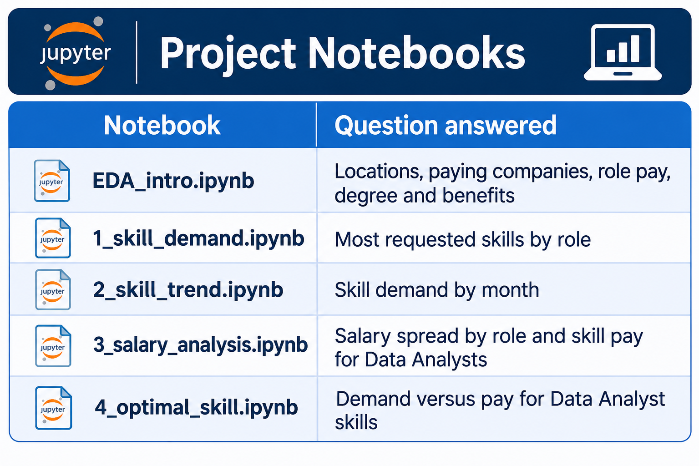

---

# Introduction

Data careers are frequently discussed in broad global terms, but job seekers need market-specific evidence.

This project answers the following questions:

1. Where are data jobs located in Finland?
2. Which companies pay the most?
3. What do different roles pay?
4. Which skills are most requested?
5. Does skill demand change through the year?
6. Which skills balance salary and demand best?
7. How often are degrees mentioned in job postings?

---

# Methodology

## Tools

- Python
- Pandas
- Matplotlib
- Seaborn
- adjustText
- Jupyter Notebooks
- Git & GitHub

## Notebooks

- [EDA Introduction](jobs_Project/EDA_intro.ipynb)
- [Skill Demand Analysis](jobs_Project/1_skill_demand.ipynb)
- [Skill Trend Analysis](jobs_Project/2_skill_trend.ipynb)
- [Salary Analysis](jobs_Project/3_salary_analysis.ipynb)
- [Optimal Skill Analysis](jobs_Project/4_optimal_skill.ipynb)

## Techniques

- Data cleaning
- Salary analysis
- Location analysis
- Skill demand calculations
- Trend analysis
- Company comparison
- Data visualization

---

# Findings and Insights

## Insight 1: The Capital Region Is Where the Jobs Are

Helsinki is the clear center of Finland's data job market, with approximately 1,700 postings, compared with roughly 445 in Espoo and 105 in Tampere.

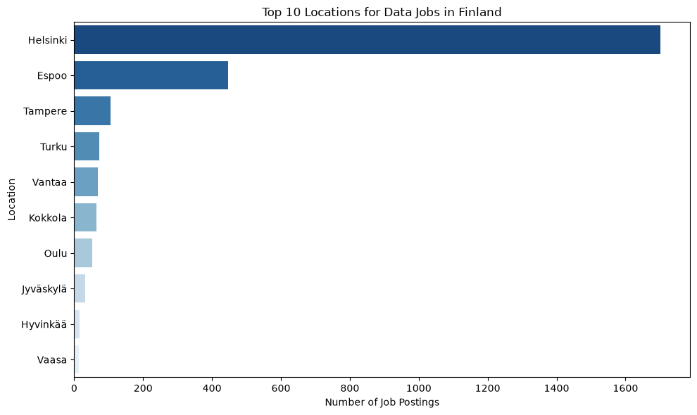

Technical notebook: [EDA_intro.ipynb](jobs_Project/EDA_intro.ipynb)

---

## Insight 2: Industrial and Technology Companies Lead on Pay

Wärtsilä, Nortal and Nitor emerged as the highest-paying employers in the analysis. The difference between the highest and tenth-ranked company exceeded €50K.

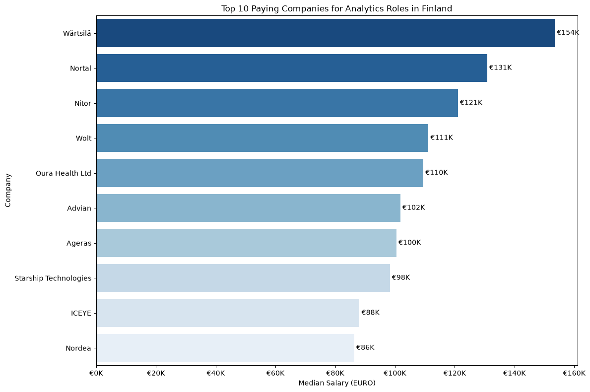

Technical notebook: [EDA_intro.ipynb](jobs_Project/EDA_intro.ipynb)

---
## Insight 3: Seniority and Specialisation Lift Salaries

Median salaries by role:

- Data Analyst: €87K
- Business Analyst: €94K
- Data Engineer: €97K
- Data Scientist: €105K
- Senior Data Analyst: €106K

### Role Salaries

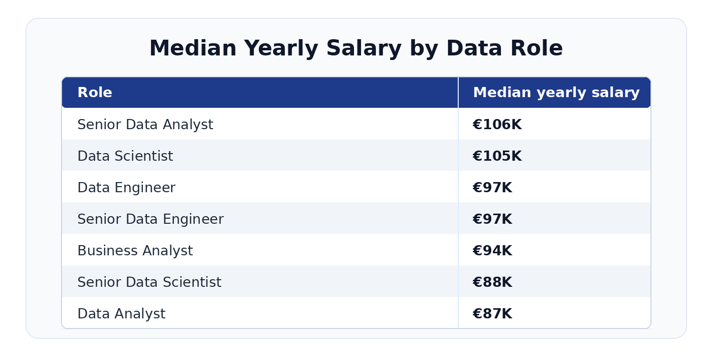

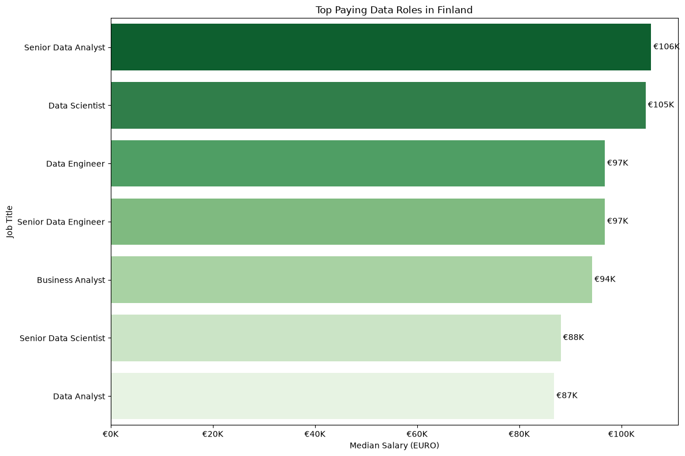

### Salary Distribution

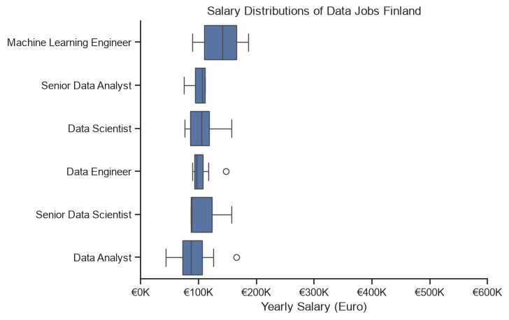

Technical notebooks:
- [EDA_intro.ipynb](jobs_Project/EDA_intro.ipynb)
- [3_salary_analysis.ipynb](jobs_Project/3_salary_analysis.ipynb)

---

## Insight 4: SQL and Python Form the Foundation

For every major role examined, SQL and Python were consistently among the most requested skills.

- Data Analysts: SQL, Python, Power BI
- Data Engineers: Python, SQL, Azure
- Data Scientists: Python, SQL, R

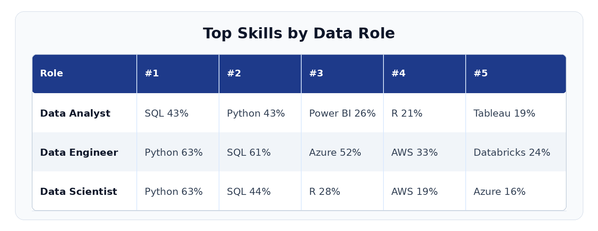

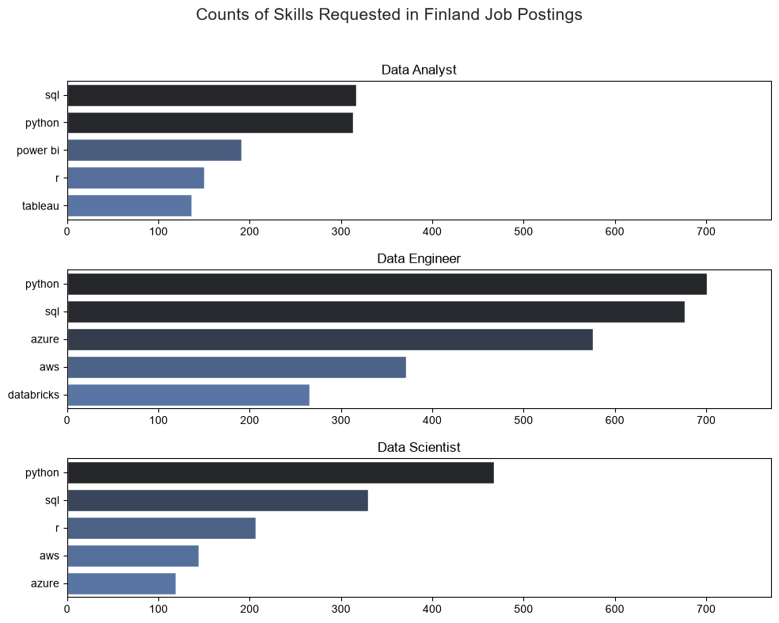

Technical notebook: [1_skill_demand.ipynb](jobs_Project/1_skill_demand.ipynb)

---

## Insight 5: Core Skills Stay Consistent Throughout the Year

Python and SQL remain the top skills throughout the year. Azure remains consistently strong while Power BI maintains stable demand.

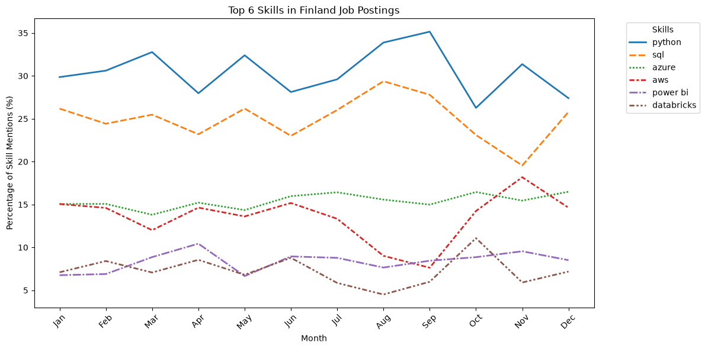

Technical notebook: [2_skill_trend.ipynb](jobs_Project/2_skill_trend.ipynb)

---

## Insight 6: Some Skills Command Higher Salaries

Among salary-listed Data Analyst postings, Azure, Go, Alteryx and Looker appeared to be associated with higher salaries. Because of the limited sample size, these findings should be treated as directional rather than definitive.

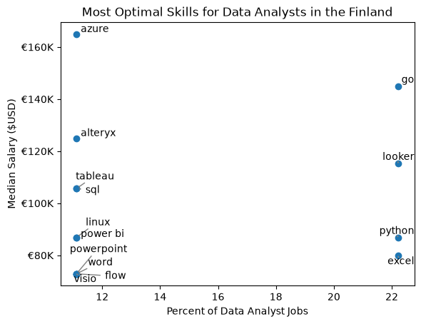

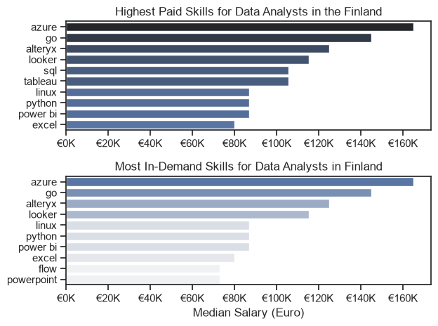

Technical notebook: [4_optimal_skill.ipynb](jobs_Project/4_optimal_skill.ipynb)

---

## Insight 7: Nearly Half of Postings Do Not Mention Degrees

45.9% of Finland data-role postings did not mention a degree requirement.

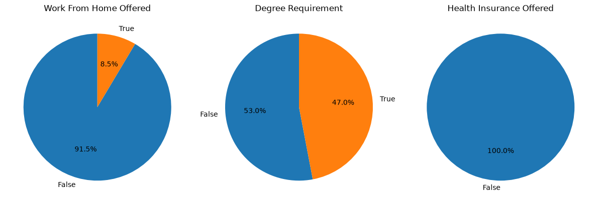

Technical notebook: [EDA_intro.ipynb](jobs_Project/EDA_intro.ipynb)

---

# Recommendations

## For Job Seekers

- Learn SQL and Python first.
- Add Power BI for analyst-focused careers.
- Develop Azure skills for engineering-focused paths.
- Focus applications on Helsinki and Espoo.
- Build a strong project portfolio.

## For Educators

- Make SQL and Python foundational topics.
- Create specialised tracks for analytics, engineering, and data science.

## For Employers

- Publish salary ranges whenever possible.
- Improve transparency around benefits and working arrangements.

---

# Project Limitations

- Job postings reflect advertised requirements rather than actual hiring outcomes.
- Salary analyses were limited by the number of postings that disclosed compensation.
- Some company-level salary samples were small.
- Monthly analysis combines multiple years.

---

# Conclusions

The Finnish data job market is heavily concentrated around the capital region. SQL and Python form the foundation across virtually all data careers, while Power BI, Azure and R help differentiate specialist paths.

For aspiring professionals, the strongest evidence-based roadmap is:

**SQL → Python → Power BI/Azure → Role Specialisation**

Building strong projects alongside those skills provides the clearest route into Finland's data job market.
